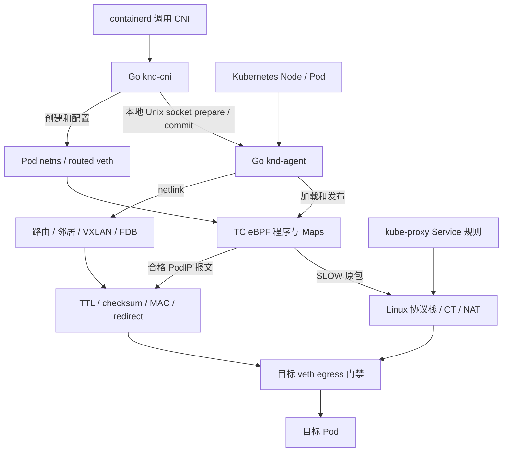

# KubeNetDoctor

一个用于学习和展示容器网络研发能力的 **Go CNI + 节点 Agent + TC eBPF 三层转发**项目。普通 Pod 的接入、控制面状态转换和快路径由本项目实现；Service 使用 kube-proxy，VXLAN 封装使用 Linux 内核。

当前已在两个独立内核的 QEMU/KVM 节点中运行真实 Kubernetes/containerd，通过 Native、VXLAN、Service、ACL 和生命周期功能实验。最终实验集群运行 `vxlan-fast`，Agent 通过 DaemonSet 部署。完整证据与未测范围见 [实施状态](docs/implementation-status.md)。这是功能原型，短时性能实验没有证明稳定的吞吐收益；也不代表生产可用性认证。

## 实现了什么，有什么意义

| 我们写的部分 | 实际工作 | 可以展示的研发能力 |
|---|---|---|
| `knd-cni` | ADD/DEL/CHECK/VERSION、host-local IPAM 委托、veth、/32 地址/路由/静态邻居、持久事务、失败清理 | runtime 接口、Linux 网络编程、并发与资源生命周期 |
| `knd-agent` | Watch Node/Pod、核验 UID、接收本地 prepare/commit、管理路由/邻居/VXLAN/FDB、发布 BPF 快照 | Kubernetes 网络控制面、身份一致性、内核对象管理 |
| TC eBPF | 校验入口与报文、查询 conntrack/FIB、修改 TTL/checksum/MAC、redirect、目标门禁和原因计数 | C/eBPF 内核编程、真实转发路径与 NAT 共存 |
| 辅助 ACL、`kndctl` | 按 Pod UID 配置有向 TCP/UDP 拒绝、紧急端点阻断、查看状态/原因 | 快慢路径一致性、可诊断性和安全失败处理 |
| 验收脚本 | 真内核、真实 runtime、抓包、100 次 Pod 生命周期、故障注入和性能对照 | 把“原理正确”变成可复现的工程证据 |

复用 host-local、CNI/netlink/client-go/cilium-ebpf 库与 Linux TCP/IP、FIB、conntrack/NAT、VXLAN。没有部署 Calico/Cilium 替我们完成 Pod 网络，没有自行重写 TCP 栈、Service 负载均衡或分布式 IPAM。

## 架构和主要路径



- 同节点：源 Pod → 宿主 veth ingress BPF → FIB/CT 检查 → 修改头部并 redirect → 目标 veth egress 检查 → 目标 Pod。
- Native 跨节点：源节点 BPF → underlay → 目标节点 underlay ingress BPF → 目标 veth。每节点三层转发各减一次 TTL。
- VXLAN 跨节点：源 BPF → `kndvx0` → Linux 封装 NodeIP/UDP/VNI 42 → 远端 Linux 解封装 → `kndvx0` ingress BPF → 目标 veth。
- Service：VIP 请求走 Linux/kube-proxy DNAT；回包在有 NAT 状态的节点被 CT guard 识别并交回内核完成反向 NAT。

报文不经过 Agent 的 Go HTTP 服务。eBPF 与 CNI 分属内核逐包处理和用户态生命周期接口，可以在同一网络系统内协作。[逐步讲解](docs/learning-guide.md) · [详细路径](docs/network-topology.md) · [与 Calico/Cilium/iptables/IPVS 的关系](docs/technical-decisions.md)

## 在当前电脑查看

在 PowerShell 的 `D:\KubeNetDoctor` 中执行。`scripts/wsl.py` 仅包装 WSL 命令；Go/eBPF 需要 Linux 构建和运行。

```powershell
python scripts/wsl.py python3 /mnt/d/KubeNetDoctor/scripts/vm-lab.py status
python scripts/wsl.py python3 /mnt/d/KubeNetDoctor/scripts/vm-lab.py ssh 1 '/usr/local/bin/k3s kubectl get nodes -o wide'
python scripts/wsl.py python3 /mnt/d/KubeNetDoctor/scripts/vm-lab.py ssh 1 '/usr/local/bin/k3s kubectl get pods -A -o wide'
python scripts/wsl.py python3 /mnt/d/KubeNetDoctor/scripts/vm-lab.py ssh 1 '/opt/knd/kndctl doctor'
python scripts/wsl.py python3 /mnt/d/KubeNetDoctor/scripts/vm-lab.py ssh 1 '/opt/knd/kndctl counters'
```

实验地址：节点 `192.168.77.11/12`；PodCIDR `10.244.0.0/24`、`10.244.1.0/24`；ServiceCIDR `10.96.0.0/12`。Pod IP 随重建变化，请查询实际值。`knd-test` 中 a/b 在 node1，c 在 node2；local/remote/hairpin Service 和 CoreDNS 可供学习。

两个 VM 各配置 2 vCPU、4 GiB 内存；磁盘/SSH 私钥位于 WSL `/root/.cache/kubenetdoctor-lab`。现有 Windows Docker/kind 集群没有被接管。停止与恢复专用实验 VM：

```powershell
python scripts/wsl.py python3 /mnt/d/KubeNetDoctor/scripts/vm-lab.py down
# 恢复时在一个持续打开的终端运行，命令会前台维持两个 VM；磁盘保留。
python scripts/wsl.py python3 /mnt/d/KubeNetDoctor/scripts/vm-lab.py up
```

停止是实验 VM 的受控进程终止，不是业务无损关机。恢复后等待 k3s/DaemonSet 就绪，再用 `doctor` 检查。已修复 `/run/knd` 重启后缺失造成的 DaemonSet 启动问题；实验中出现过一次未定位根因的 guest kernel panic，见 [故障记录](docs/experiments/environment-incidents.md)。

## 构建、重现与源码入口

在 WSL 中：

```bash
cd /mnt/d/KubeNetDoctor
source scripts/env.sh
export GOMAXPROCS=4
make build bpf test vet
python3 tests/cni/run.py
python3 tests/datapath/run.py
python3 tests/kubernetes/run.py
python3 tests/kubernetes/daemonset.py
```

namespace/BPF/Kubernetes 实验需要 root 和对应内核能力。这些脚本会创建、删除本项目的测试对象；Kubernetes 脚本只针对 `vm-lab.py` 的专用 VM。脚本不是面向任意生产集群的安装器。新机器从 [环境报告](docs/environment.md)、`scripts/bootstrap-linux.sh`、`scripts/download-tools.sh`、`scripts/download-vm-image.py`、`scripts/download-k3s.py`、`scripts/install-lab-k3s.py` 开始，先检查脚本参数和本机拓扑。

| 入口 | 阅读内容 |
|---|---|
| [cmd/knd-cni/main_linux.go](cmd/knd-cni/main_linux.go) → [internal/cni](internal/cni) | CNI 入口、事务、接口操作、Agent 协议 |
| [internal/agent/agent_linux.go](internal/agent/agent_linux.go) | API 同步、控制循环、prepare/commit、快照与恢复 |
| [internal/network](internal/network) | 宿主/Pod 网络、路由与 VXLAN 控制 |
| [internal/datapath](internal/datapath) | Go ABI、快照编译、加载/挂接/发布 |
| [bpf/datapath.c](bpf/datapath.c)、[bpf/abi.h](bpf/abi.h) | TC 转发、目标门禁和 C/Go ABI |
| [tests](tests) | 每阶段运行脚本、故障注入与性能工具 |

阅读顺序：[学习导读](docs/learning-guide.md) → [架构](docs/architecture.md) → [Service 合同](docs/service-compatibility.md) → [实施状态与证据](docs/implementation-status.md) → [性能报告](docs/experiments/M7.md) → [已知边界](docs/known-limitations.md)。原设计和阶段估时保留用于学习规划，不能代替实际结果。源码、部署清单、实验记录和构建产物的 [SHA256 清单](docs/artifact-manifest.json) 用于固定本次交付；`scripts/archive-results.py` 可重新生成。
