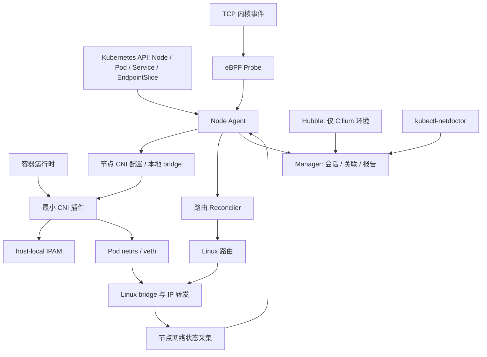

# KubeNetDoctor — 容器网络实现、状态核对与跨层诊断

修订日期：2026-11-16。目标岗位：CNI、容器网络控制面与数据面开发。

本文是待实施的设计方案，不表示其中的模块、兼容性或性能已经验证。原始诊断方向方案保存在 `docs/archive/设计方案_v1_诊断方向.md`，后续开发以本文为准。

## 一、项目定位与核心取舍

项目保留 KubeNetDoctor 名称，将主线调整为：

> 在隔离的 Kubernetes 实验集群中，实现一个最小 IPv4 CNI 插件和节点路由控制器；建立从 Kubernetes 网络期望状态到 Linux 实际转发状态的可验证链路，再通过网络状态快照、自研 TCP eBPF 探针和可选 Hubble 接入解释通信异常。

形成三个可独立验收的能力层次：

1. **建网**：CNI ADD/DEL/CHECK、veth、netns、bridge、IPAM 委托和资源生命周期。
2. **维护网络**：监听 Node 变化，计算并协调本节点路由，处理重启、漂移、删除和并发。
3. **解释网络**：比较期望配置、实际内核状态与运行事件，输出证据、假设和未知项。

本项目使用 Linux 已有 bridge/IP 转发作为首个数据面，自研代码负责配置和维护该数据面。TCP tracepoint 程序是观测探针，不能在简历中描述为自研 eBPF 转发引擎。

不以实现生产级 CNI 为目标。暂不自研分布式 IPAM、BGP、VXLAN 控制器、Service 负载均衡器或完整 NetworkPolicy 引擎。Hubble 接入后置，避免在基础网络还未掌握时同时承担全部工作。

| 岗位能力 | 本项目的直接实现 | 必须展示的证据 |
|---|---|---|
| CNI 与容器生命周期 | 自研 CNI 入口、IPAM 委托、veth 配置与回滚 | ADD/DEL/CHECK、异常退出和资源回收实验 |
| 容器网络控制面 | client-go Informer、Workqueue、路由 Reconcile | Node 变化、幂等、重启重建、漂移恢复 |
| Linux 数据面 | netns、bridge、路由、邻居表、MTU、转发条件 | 同节点/跨节点路径及双向连通性 |
| Service 与策略理解 | 复用并检查 kube-proxy；在独立 Cilium 环境观察策略 | ClusterIP 转换证据、策略拒绝与普通丢包对照 |
| eBPF 与 Go 工程 | TCP 探针、Ring Buffer、有限会话与取消 | 真内核加载、双向重传、丢失统计和资源上限 |

## 二、范围、版本与两种实验环境

### 2.1 分期范围

| 版本 | 必做内容 | 完成定义 |
|---|---|---|
| v0.1 网络主线 | 单集群、Linux、IPv4、普通 Pod；最小 CNI、host-local IPAM、直接路由控制器、状态核对 CLI | 多节点 PodIP 双向通信；故障可定位；路由可幂等恢复 |
| v0.2 诊断主线 | 双端 TCP eBPF、会话管理、Manager、证据报告；固定 kube-proxy 模式的 ClusterIP 实验 | 将通信异常与可验证配置/内核事件关联，正确表达采集缺口 |
| v0.3 Cilium 适配 | 独立 Cilium 集群、Hubble gRPC、NetworkPolicy、固定模式 Service 转换 | 同一报告模型支持 Cilium 证据，验证诊断的适用边界 |

v0.1 不承诺 NetworkPolicy、Pod 出网、NodePort、LoadBalancer、hostPort、IPv6、hostNetwork 业务 Pod、多网卡、Service Mesh 或多集群支持。实验 Agent 的 hostNetwork 部署是基础设施引导措施，不表示支持诊断 hostNetwork 业务。

### 2.2 严格区分两个部署模式

| 配置 | `lab-cni` | `cilium-observe` |
|---|---|---|
| Pod 网络提供者 | 自研最小 CNI | Cilium |
| 项目 Agent | 管理项目拥有的 bridge/路由，并提供诊断 | 仅采集诊断证据，不写 Cilium 网络配置 |
| IPAM | 复用 host-local，节点网段来自 Node.spec.podCIDR | 由 Cilium 管理 |
| Service 实现 | 复用 kube-proxy，M0 固定版本和模式 | 固定 Cilium kube-proxy replacement/socket LB 配置 |
| Hubble | 不启用，也不作为就绪依赖 | 可选诊断数据源 |

两个模式使用不同集群或销毁后重建的实验环境。首版不设计 CNI chaining，不把两个主 CNI 同时装进一个集群，也不尝试让 Hubble 观察自研 CNI 数据面。

### 2.3 环境前提与版本锁定

- 第一组跨节点实验采用受控二层网络中的 Linux 虚拟机：节点地址可作为直连下一跳，网络允许携带 Pod 源地址的报文。云上同一子网不自动满足这些条件；需要核查反欺骗限制、路由和转发能力。
- 推荐先用单机 netns 验证机制，再用独立内核的多节点虚拟机完成正式验收。若云环境不支持直接路由，优先调整实验拓扑；后续可用成熟 Cilium overlay 环境验证诊断，不能宣称已实现自研 overlay。
- M0 固定 Linux/发行版、Kubernetes、containerd、CNI spec 与库、host-local、Go、Clang/LLVM、cilium/ebpf 版本；v0.3 额外固定 Cilium/Hubble 与安装配置。
- CNI 原型先实现并声明 spec 1.0.0 的 ADD、DEL、CHECK、VERSION；使用支持该规范的固定 runtime。不得宣称已经支持 1.1 的 STATUS/GC，升级另行验收。[CNI 1.0 规范](https://github.com/containernetworking/cni/blob/spec-v1.0.0/SPEC.md)、[规范升级说明](https://www.cni.dev/docs/spec-upgrades/)
- 当前已知本机为 Windows，安装过 Docker Desktop 和 WSL。此前基础查询找到相关命令，但 Docker Linux Engine 未连接、WSL 查询返回 E_ACCESSDENIED；实际内核、BTF、tracepoint、权限与资源均待 M0 验证。
- kind 可用于部分 Kubernetes 集成测试，但其节点是共享宿主内核的容器。全局 tracepoint 不会自动按 kind Node 隔离，必须验证过滤范围，不能将 Agent 所在 Node 直接作为事件归属。[kind](https://kind.sigs.k8s.io/)、[Docker 容器与内核](https://docs.docker.com/get-started/docker-concepts/the-basics/what-is-a-container/)

## 三、总体架构与责任边界



这是逻辑架构。M0–M3 先完成 CNI、Agent 与直接读取 Agent/离线快照的 CLI；M5 再引入 Manager，无需开工就创建所有进程。

| 组件 | 责任 | 不承担的责任 |
|---|---|---|
| CNI 二进制 | 被 runtime 调用，配置/清理一个容器网络附件，返回标准结果 | 不长期 Watch，不依赖 Manager 发起建网 |
| Node Agent | 节点网络引导、路由维护、状态采集、eBPF 与限时会话 | 不替代集群 IPAM，不接管其他 CNI 的资源 |
| Manager | 多节点诊断编排、元数据、证据关联、报告 | 不作为 CNI ADD 或正常转发的可用性依赖 |
| CLI | 目标解析、会话交互、快照与报告展示 | 不把 Shell 文本拼接作为核心网络实现 |

Manager 首版单副本。无 Kafka、Redis、Elasticsearch、ClickHouse、通用数据库或诊断 CRD。CNI/IPAM 的节点本地持久状态是恢复所需，不受“诊断不引入数据库”的限制。

## 四、最小 CNI 与 Linux 数据面

### 4.1 首个可解释的数据路径

采用每节点一个 bridge、每 Pod 一对 veth、节点间直接路由：

```text
同节点：Pod A eth0 → host veth → bridge → host veth → Pod B eth0
跨节点：Pod A eth0 → veth → bridge 网关 → Node A 路由
        → underlay → Node B 路由 → bridge → veth → Pod B eth0
```

示例地址仅用于讲解，实际 M0 需避开本机、VPN、Service 与现有网络：Node A PodCIDR `10.244.1.0/24`，Node B PodCIDR `10.244.2.0/24`。在 A 上为 B 的 PodCIDR 安装经 B underlay IP 的路由，在 B 上配置反向路由。Pod 间通信保持原始 Pod IP，不额外做 SNAT。

Agent 建立并拥有本节点 bridge、网关地址和节点配置；CNI 每次调用只管理自己的 veth/Pod 地址/Pod 路由。CNI DEL 不删除共享 bridge。M1 尚无完整 Agent 时，由测试环境准备程序调用同一节点初始化逻辑，M2 再接入 Agent，不能让 CNI 依赖尚未实现的服务。安装时一并验证标准 loopback 插件及 runtime 的回环接口处理。bridge 的联网机制可与官方插件对照，项目仍需自己实现接口编排，不能仅委托官方 bridge 插件后宣称自研。[bridge 插件说明](https://www.cni.dev/plugins/current/main/bridge/)

数据面前提要显式检查：IPv4 forwarding、MTU、邻居可达性、路由优先级、rp_filter、宿主防火墙以及可能启用的 bridge netfilter。不得通过清空整个防火墙或全局关闭检查来掩盖配置问题。实验配置若需改变 sysctl/转发规则，应限定、记录并提供恢复方式。

### 4.2 地址分配与启动顺序

1. 集群安装配置为各节点分配不重叠的 IPv4 PodCIDR；本项目消费 Node.spec.podCIDR，不自行实现集群网段分配器。
2. Agent 使用 hostNetwork 启动，并容忍集群引导阶段所需的调度条件；通过显式可达的 API Server 地址访问 API，避免先依赖 Pod 网络或 ClusterIP。
3. Agent 核对本节点网段、网关、underlay 接口与路由冲突，准备 bridge 与网关，原子发布节点 CNI 配置，再报告网络配置就绪。
4. runtime 调用自研 CNI；CNI 委托 host-local 分配该节点网段内的地址，再通过 netlink 配置 veth、Pod 地址和路由。
5. 路由控制器异步维护跨节点可达性；“本地 CNI 配置就绪”和“跨节点路由已收敛”分别报告。

host-local 只保证单节点分配唯一性，全局唯一性依赖互不重叠的节点 PodCIDR。网关、保留地址与可分配区间必须统一生成。[host-local 文档](https://www.cni.dev/plugins/current/ipam/host-local/)

已有 Pod 时，节点 PodCIDR 变更不自动迁移地址；报告不支持并通过排空、重建实验节点处理。节点配置缺失、网段冲突或接口选择不唯一时拒绝 ADD，不能猜测配置继续建网。

### 4.3 CNI 生命周期与异常恢复

- `ADD`：解析配置与标准环境参数，验证网络附件身份，委托 IPAM，创建 veth 并配置 netns 内网络，记录完成状态，输出标准 JSON；日志写 stderr。支持的配置与调用语义严格以固定规范为准。
- `DEL`：以 network/containerID/ifName 定位本插件资源；允许重复清理，netns 已不存在时仍尝试释放 IPAM 与本地状态。不得按 Pod 名称或截断后的名称误删其他附件。
- `CHECK`：核对附件、地址、路由与 MTU，并按规范调用委托 IPAM 的 CHECK；只验证，不顺便修复。
- `VERSION`：报告实际实现并通过测试的规范版本。

持久记录最少包括网络名、容器 ID、接口名、分配结果、资源标识与创建阶段。文件原子更新并对同一附件串行化；共享 bridge 由 Agent 单一所有者管理。宿主接口名需满足长度限制，并检测截断/哈希冲突。

普通 ADD 失败要回滚本次创建的资源并释放 IP；处理 SIGKILL 等无法执行回滚的情况时，依靠后续 DEL 和显式审计发现残留。没有 runtime/附件存活证据时不按“超时”自动释放地址，以免双重分配。不得把这一审计功能描述为已实现 CNI 1.1 GC。

通过 netlink 操作接口、地址与路由，复用成熟 netns 工具处理 Go 线程切换和命名空间恢复；不能让切换过 netns 的线程污染后续 goroutine。具体库和 API 在实施前核查。

## 五、容器网络控制面：节点路由协调

### 5.1 从期望状态到实际状态

Node Agent 用 client-go 的 Informer、Indexer/Lister 与限速 Workqueue 监听 Node，基于最新快照计算本节点路由集合。事件只触发重新计算，不能把一串 Add/Delete 回调当作唯一事实源。参考 [Kubernetes sample-controller](https://github.com/kubernetes/sample-controller)。

```text
Node 快照 → DesiredRoutes → ReadObservedRoutes → Diff
         → ApplyOwnedChanges → ReadBack → ReportStatus
```

路由计划至少包含目的 PodCIDR、下一跳 InternalIP、出接口、表、协议标记、所属远端 Node UID 和计划版本。首版固定单 IPv4 underlay、单个选定 InternalIP 和主路由表；多网卡/策略路由场景直接标记不支持，避免错误的“缺少主表路由”判断。Agent 通过 netlink 配置节点网络；跨节点 TCP 数据实际由 Linux 内核转发，不经过 Manager 或 gRPC。

### 5.2 协调规则

- informer 同步后才协调；Node 加入、删除、地址变化和周期性检查均触发计算。
- 对所属资源做幂等的创建/更新，读回验证；正常情况下反复 reconcile 不产生额外写操作。
- 以项目路由 protocol 标记、精确路由属性和本地所有权记录共同限制修改范围；遇到已有非项目同目的路由时报告冲突，不盲目覆盖。标记数值在 M0 选择并核查冲突。
- 明确删除的 Node 可触发清理其项目路由；暂时 NotReady、Watch 断开、API 不可达或缓存尚未同步不能被解释成节点已删除。
- Agent 重启后从 API、内核和本地记录重建；API 暂不可用时保留已知转发状态并报告 stale，不大面积删路由。
- 记录 desired/observed 差异、最后成功协调时间、重试与冲突；状态被篡改时能发现并在后续协调中恢复。
- 正常转发不经过 Agent 用户态。Agent 停止后已有接口/路由应保留，控制面暂时停止收敛；新建 Pod 的可用性取决于已发布配置与 IPAM 状态，不承诺跨节点变化仍可生效。

自动协调仅适用于 `lab-cni` 内项目拥有的资源。这属于网络控制器的正常职责；诊断 API 不提供任意路由修改或“自动修复 Cilium”功能。

## 六、网络状态核对与诊断

### 6.1 先检查实际配置，再解释动态事件

Node Agent 采集带时间和来源的网络快照：

- 已确认目标 Pod 的 netns、veth 对端、bridge 归属、接口状态与 MTU。
- 地址、路由、规则、邻居状态及与当前目标有关的转发条件。
- `lab-cni` 的期望路由、实际路由、最近 reconcile 结果。
- Service/EndpointSlice 的候选后端与就绪状态；v0.2 再接入选定 kube-proxy 模式下的相关转换证据。

实际路由判断需考虑目标、源地址与已支持的规则；“存在路由”不证明链路可达。快照不是全局原子状态，应记录开始/结束时间、相关对象版本和期间变化，变化中输出不确定状态。

自研 CNI 通过附件记录保存容器网络身份，结合 Kubernetes Pod UID、sandbox 身份和事件时段校验 netns。Cilium 环境另做有版本边界的身份适配，不能假设 Kubernetes Pod API 直接给出宿主 netns 路径，也不能把 Cilium security identity 当作 Pod UID。

### 6.2 TCP eBPF 探针

保留原方案的 C + cilium/ebpf + bpf2go 路线，优先验证 `tcp:tcp_retransmit_skb`。按诊断需要再增加 TCP 状态变化观测，不一次铺满所有 hook。实际字段、BTF、helper 可用性及 verifier 必须在目标内核验证。[Linux TCP tracepoint 源码](https://github.com/torvalds/linux/blob/master/include/trace/events/tcp.h)

采集地址、端口、地址族、内核时间，以及经验证可获得的 socket/netns 标识；通过有界 Ring Buffer 上报并统计 reserve/output 失败。该缓冲区不会因用户态消费慢而阻塞内核等待。[Linux Ring Buffer](https://docs.kernel.org/bpf/ringbuf.html)

重传可能发生在定时器上下文。current PID 和 current cgroup 都不能单独代表 Socket 所有者；netns cookie、socket cookie 的 helper 是否适用于当前 hook 也必须实测。没有可靠生命周期标识时，五元组复用应降级为候选关联，而非确定连接。

对源与目标 Pod 所在节点都创建追踪范围，同节点只采集一次；明确两侧 socket 的标识不同，不能把 socket cookie 当作跨节点统一连接 ID。Pod 重建时锁定原 UID 并结束或降级会话，不静默跟随同名新 Pod。

### 6.3 会话、事件模型与资源上限

会话状态：`Preparing → Ready → Collecting → Draining → Completed`；失败和取消分别进入终态。Agent 过滤生效、必要的数据源建立、元数据同步后再提示 Ready。数据源没有强就绪确认时记录准备窗口，不能伪造无缺口覆盖。

- 一个 Agent 共享探针；内核粗过滤取活动会话的并集，Agent 串行维护引用计数，用户态再按会话分发。
- 每个会话有最大时长、独立有界队列和丢弃统计；全局有会话数、缓存大小和发送速率上限，数值在 M5 按环境设定并测试。
- 会话重复请求使用幂等 ID；Manager 失联后 Agent 依靠本地 deadline 清理。结束时先停止新增范围，再有限排空并记录未排空数据。
- 慢消费者不得阻塞其他会话；Manager 重启后原会话失败，首版不实现会话高可用恢复。
- 事件模型包含 schema version、source、采集实例标识/序号、node/bootID、事件时间与接收时间、原始方向、五元组、可选身份、关联依据和质量标志。
- 对本地单调时钟做墙上时间校准，保留原始值、校准区间和误差；节点时钟偏差或时间跳变会降低跨节点关联可信度。[Linux helper 的时间与 current cgroup 定义](https://raw.githubusercontent.com/torvalds/linux/v6.6/include/uapi/linux/bpf.h)
- 用有界窗口和迟到容忍处理乱序；连接新建/关闭、元数据变更和 IP 复用进入匹配测试。Informer 事件接收时间不能伪装成精确的 IP 分配时间。
- 区分同一数据源重复投递与不同节点的独立观测，不能按五元组直接去重。没有稳定事件 ID 时采用保守标记，并说明去重能力限制。

### 6.4 Hubble 与 Service/策略扩展

仅在 v0.3 的 Cilium 环境中，通过 Relay Observer gRPC 消费 GetFlows，处理双向过滤、TLS/mTLS、重连、取消，以及 flow/node_status/lost_events 等响应。不得 Shell 调用 `hubble observe` 解析文本作为核心接入。[Observer API](https://docs.cilium.io/en/stable/_api/v1/observer/README/)

Hubble 的事件可能聚合，缓存有界，也不是完整历史抓包。保留采集缺失与实际可回溯范围；数据源不可用时输出部分结果，不能当作“网络没有事件”。[Hubble 内部机制](https://docs.cilium.io/en/stable/internals/hubble/)、[事件聚合配置](https://docs.cilium.io/en/stable/network/kubernetes/configuration/)

Service → EndpointSlice 只说明候选后端，不能确定一次连接实际选中了谁。必须在固定数据路径下补充连接/NAT 或转换事件证据。Cilium socket LB 可能在 connect 阶段改写目的地址，因此不能假定原始 ClusterIP 总出现在 TCP 重传事件中。[EndpointSlice](https://kubernetes.io/docs/concepts/services-networking/endpoint-slices/)、[Cilium socket LB](https://docs.cilium.io/en/stable/network/kubernetes/kubeproxy-free/#socket-loadbalancer-bypass-in-pod-namespace)

NetworkPolicy 实验包括默认拒绝、显式放行和标签变更，观察声明规则、实际拒绝事件与生效延迟。首版不实现完整策略语义求值器；读取策略 YAML 不等于证明数据面已经执行该策略，也不从一个 DROP 猜出不存在的具体规则归因。[Kubernetes NetworkPolicy](https://kubernetes.io/docs/concepts/services-networking/network-policies/)

## 七、CLI、报告与诊断规则

以下是目标接口，尚未实现：

```text
kubectl netdoctor inspect --pod default/client --output json
kubectl netdoctor check-path --source default/client --destination default/server --port 8080
kubectl netdoctor diagnose --source default/client --destination default/server --port 8080 --duration 30s
kubectl netdoctor diagnose --source default/client --service default/backend --port 80 --duration 30s
```

最后一条 Service 命令属于后续阶段。`inspect` 收集配置，`check-path` 比较已支持模式的期望与实际状态，`diagnose` 限时收集动态证据。默认不主动发业务请求，测试流量由独立测试程序产生；无流量时报告“未观测到目标通信”。

报告包括：

| 字段 | 内容 |
|---|---|
| Target / Scope | Pod UID、节点、方向、端口、版本、网络模式和观察时间 |
| ExpectedState / ObservedState | 期望路由/接口状态与采集到的实际状态及差异 |
| Observations / Evidence | 观测事实、来源、时间、证据 ID 与采集条件 |
| Association | Pod 归属和连接关联分别给出 Confirmed/Probable/Ambiguous/Unknown 及理由 |
| Hypotheses / Unknowns | 候选解释、反证和仍缺少的证据 |
| CollectionStatus | 数据源、覆盖节点、断连、溢出、过期、迟到与时钟误差 |
| Recommendations | 下一步检查建议，不隐式修改网络 |

诊断规则采用可测试的显式条件，避免凭阈值给出没有校准依据的“95% 根因概率”。例如：

- 目标 PodCIDR 的期望路由缺失，可确认该时刻存在配置差异；要说明它是否造成目标连接异常，还需结合实际查路与动态证据。
- Hubble 的 policy deny 是对应观测点拒绝事件的证据，不直接证明整个集群策略配置均正确。
- 重传证明发送方发生重传；不能直接确定物理丢包、拥塞、ACK 丢失或接收方处理问题。
- 接口/MTU 差异是检查线索；没有报文长度、路径或相关错误证据时不能确定 PMTU 黑洞。
- 无重传、无 Hubble 响应、没有 DROP 事件均不单独证明网络健康或故障。

## 八、开发阶段与停止条件

每个阶段先说明机制、接口、风险与验收，再做一个可理解的增量。阶段验收通过后才继续；未完成的能力不能写成项目成果。

| 阶段 | 主要工作 | 独立验收 |
|---|---|---|
| M0 环境与手工网络 | 检查实际 Linux/BTF/权限；用 netns/veth/bridge 建立最小通信；确定独立节点拓扑和版本 | 能画出并用命令/抓包解释路径；环境清单可复现；最小 eBPF 加载能力探测成功 |
| M1 单节点 CNI | Go CNI 入口、host-local 委托、netlink 编排、DEL/CHECK、持久记录 | cnitool/真实 netns 验证标准结果、双向通信、重复 DEL、IP 回收、ADD 失败回滚 |
| M2 Kubernetes 与跨节点 | Agent 引导、Node Informer/Workqueue、Desired/Observed 路由协调 | runtime 实际调用 CNI；跨节点双向 TCP；Node 变化、Agent 重启、重复协调、API 断连行为正确 |
| M3 状态核对与故障定位 | netns/veth/route/neighbor/MTU 快照、归属、inspect/check-path | 能发现受控的配置差异；不误归属重建 Pod；节点/元数据变化中明确降级 |
| M4 TCP eBPF | 双端重传事件、Ring Buffer、身份与时间模型 | 真内核加载；两个方向的重传都可捕获；无关 Pod 被过滤；丢失有计数 |
| M5 诊断会话与工程化 | Manager/CLI、共享探针、关联规则、报告、身份校验和限额 | 并发/取消/超时/失联/背压可控；采集缺口进入报告；完成多节点性能与反例实验 |
| M6 Service 与 Cilium 对照 | 先固定 kube-proxy 模式的 ClusterIP；再独立 Cilium/Hubble/策略实验 | 展示候选后端与实际连接证据的区别；政策拒绝与普通重传能区分；不改写 Cilium 资源 |

M3 可形成第一版求职演示；M5 是主要完整交付；M6 按岗位需求继续。无明确时间预算时不承诺固定周数。M0 若无法提供可用 Linux/二层环境，应先解决环境，不用 Mock 跳过网络实现。

## 九、验证、故障注入与性能

### 9.1 正确性矩阵

| 场景 | 预期行为 |
|---|---|
| CNI 配置错误/IPAM 失败/配置到一半失败 | 返回标准错误，清理本次已创建资源；已有 Pod 不受误删影响 |
| 同时 ADD 多个 Pod；重复 DEL；netns 已不存在 | 地址不重复、资源不冲突；可重复清理并释放 IPAM |
| CNI 进程被终止 | 后续 DEL/显式审计可发现并清理残留，不无证据抢占活跃地址 |
| 同节点与跨节点正常通信 | 路径与配置一致、双向可达、不生成无依据故障结论 |
| 删除项目拥有的远端路由 | 记录差异及影响；Reconciler 恢复；非项目路由不被修改 |
| Agent 重启/Watch 中断/API 不可达 | 已有转发保留；状态报告 stale；恢复后重建并收敛 |
| Node 删除/下一跳变化 | 仅更新受影响的项目路由，幂等并读回验证 |
| 请求方向/响应方向分别丢包 | 分别捕获两端发送者重传，不把事件数当物理丢包数 |
| 未监听端口/应用慢/无目标流量 | 没有足够证据时说明限制，不把这些场景一律判定为网络丢包 |
| Pod/IP/五元组复用，事件延迟与乱序 | 不错误合并生命周期；无法确定时降级 |
| 采集缓冲溢出、慢客户端、Hubble 断连 | 不无界增长；保留损失计数与覆盖缺口 |
| ClusterIP 多后端、Cilium policy deny/allow | 关联依据可追溯；未支持的转换/策略语义明确标记 |

故障注入仅在隔离环境执行，限定接口/方向/目标并提供恢复步骤。路由漂移实验分为“关闭 lab 协调器的 observe-only 故障保持”和“协调开启的自动恢复”两种测试，不能在控制器迅速修复后声称诊断观察到了持续故障。

tc/netem 等测试工具只用于故障注入，不纳入核心诊断依赖。测试程序保存真实注入位置、时间与参数作为独立评分依据，不能把这些答案传给诊断引擎。必要时用 tcpdump、ss、路由读回和工具统计交叉核对；Inspektor Gadget 可作观测对照，不能单独当作绝对真值。

### 9.2 工程检查与测量口径

- 纯逻辑测试覆盖路由计划与差异、连接关联、状态机、快照比较；并发路径运行 race 检查。
- CNI/netlink/eBPF 必须有真实 Linux 集成测试。Mock 仅验证接口行为，不替代内核验收。
- 固定拓扑、版本、负载、数据路径和故障配置，重复测量；报告样本数、分布与环境限制，不只报单次最好结果。
- 分别测量 CNI ADD/DEL 时延与失败清理、路由收敛时延与写操作次数、Agent CPU/RSS、缓存上限、事件丢失和报告延迟。
- 在同一已配置网络上比较无诊断探针、探针加载但无会话、活动诊断三种状态的吞吐和延迟，避免把网络实现差异混入探针开销。
- 重传事件数、TCP segment 数、字节数和 Hubble Flow 数是不同口径。首版报告事件计数，不用不匹配的分母生成“重传率”。
- kind 数据只支持对应共享内核环境的结论。多节点性能与控制面失效实验在独立内核环境重复验证。

## 十、工程结构、权限与交付

建议结构按阶段创建，尚未使用的包不提前抽象：

```text
cmd/knd-cni/                  CNI 可执行文件
cmd/agent/                    节点控制器与采集
cmd/manager/                  后续诊断编排
cmd/kubectl-netdoctor/         CLI
internal/cni/                 生命周期、IPAM 委托、附件记录
internal/network/             netlink、netns、快照
internal/controller/          Node 监听、路由计划与协调
internal/kubernetes/          元数据缓存与身份关联
internal/ebpf/                生成绑定、加载、事件读取
internal/session/             会话与资源上限
internal/correlation/         跨来源关联
internal/diagnosis/            显式诊断规则
internal/report/              统一报告
internal/hubble/              后续 Cilium 适配
api/proto/                    按实际通信需要定义
bpf/                          自研探针
deploy/lab-cni/                自研实验网络配置
deploy/cilium-observe/         独立 Cilium 诊断配置
tests/                        Linux 集成与端到端实验
docs/                         设计决策、实验与限制
scripts/                      环境准备、故障注入和恢复
```

工程要求：使用 Go Modules；实施前核查真实依赖/API；函数和复杂逻辑使用解释设计原因的中文注释；所有长生命周期任务支持取消、退出和错误传播；不编造性能数据或已通过测试。

权限设计应按组件拆开：CNI/Agent 需要哪些 netns、netlink、BPF、宿主目录权限在 M0 核实；实验初期若使用 privileged 必须标记，后续以实测收敛权限。Manager 不需要宿主网络管理权限，Kubernetes 访问按实际只读资源授予，Agent 的路由写操作发生在宿主内核而非任意 Kubernetes API 写权限。

Manager→Agent 使用身份校验和加密；CLI 首版可通过受 Kubernetes 权限控制的 port-forward 访问集群内 Manager，并限定为实验管理员使用，不能宣称已实现完整租户授权。v0.3 单独配置 Hubble TLS/mTLS。不得暴露无认证的宿主配置修改接口。

完成 M5 后交付：可部署 CNI/Agent/Manager/CLI、路由控制器、自研 TCP 探针、网络状态与诊断报告、真实实验脚本、测试与性能报告、架构与限制文档、可复现 README。M6 增加 Service 与 Cilium/Hubble 对照证据。

简历只写已验收成果，并明确 Linux 原生转发、host-local IPAM、kube-proxy/Cilium 的复用边界。核心亮点应落实为能演示和解释的行为，例如路由期望与实际状态协调、CNI 失败清理、双端重传关联、错误归属防护与受控性能开销。

## 十一、协作方式

以下保留原方案的八条协作规则；在此基础上增加：每阶段先解释数据包路径与关键内核机制，再拆分成可理解的小任务。演示结果必须与当前文件、实际环境和测试记录相符。

遵循以下开发方式。

### 规则 1：先理解项目，再修改代码

每次开始新阶段之前：

- 阅读已有代码。
- 检查当前架构。
- 检查已有测试。
- 明确本阶段改动范围。
- 识别技术风险。

不得在未检查现有实现的情况下重复创建模块。

### 规则 2：一次只完成一个阶段

你需要了解整个项目架构，但每次只实现当前阶段。

不能因为知道最终目标，就一次性生成整个项目的所有文件。

当前阶段必须具备独立验收能力。

### 规则 3：每阶段先给出技术方案

开始写代码前，简要说明：

- 本阶段开发目标。
- 需要创建或修改的模块。
- 核心数据结构和接口。
- 使用的关键 Linux/Kubernetes 机制。
- 技术风险。
- 验收方法。

之后再进行实现。

### 规则 4：完成后必须测试

在环境允许的情况下，主动执行：

- 编译。
- 单元测试。
- 集成测试。
- 静态检查。
- 必要的真实运行测试。

如果环境无法执行某项测试，必须明确说明未执行原因，不能报告测试通过。

### 规则 5：保留工程文档

在 docs/ 中维护：

- architecture.md
- development-plan.md
- technical-decisions.md
- known-limitations.md
- testing.md

每次出现关键架构决策时更新文档。

### 规则 6：保证我能够理解核心代码

每完成一个核心模块，你需要解释：

- 为什么这样设计。
- 核心代码的工作原理。
- 与 Kubernetes/Linux 内核的关系。
- 哪些情况下可能失败。
- 与成熟开源工具的差异。
- 面试中可能被问到的技术问题。

不要仅仅告诉我已经完成了多少代码。

### 规则 7：禁止无意义的复杂化

在加入新依赖、新服务或新抽象前，判断：

- 是否有现成可靠组件可以复用？
- 自研是否有明确价值？
- 是否增加了无法验证的复杂性？
- 是否有对应的实验和测试？

如果某个功能没有实际收益，可以建议删除或延后。

### 规则 8：每阶段汇报

每个阶段完成后，输出：

1. 已完成任务。
2. 主要代码文件。
3. 关键技术实现。
4. 执行过的测试及结果。
5. 未解决的问题。
6. 与原计划的偏差。
7. 下一阶段建议。

只有当前阶段通过验收，才能进入下一阶段。

## 十二、尚待 M0 / 各阶段确定的决策

1. 实际 Linux 内核、BTF、权限，以及本机可用的独立节点虚拟化方式；是否需要云资源。
2. 实验 underlay 是否确实满足直接路由，网段规划、节点数与资源预算。
3. 固定软件版本、CNI 库与 netlink/netns 库、kube-proxy 模式及宿主防火墙条件。
4. CNI 持久记录格式、崩溃恢复细节、网卡命名与路由所有权标记。
5. 当前 tracepoint 能取得哪些可靠身份字段，是否需要补充生命周期 hook。
6. 队列、事件窗口、时钟误差、会话限额及测试通过阈值；数值必须先声明再测量。
7. Cilium 配置和转换证据接入方式在 M6 前验证，不能用浮动的最新文档替代固定版本行为。

这些是需要以环境和实验回答的问题，不是已经实现的能力。开发开始前先完成 M0 的技术方案与环境记录。
