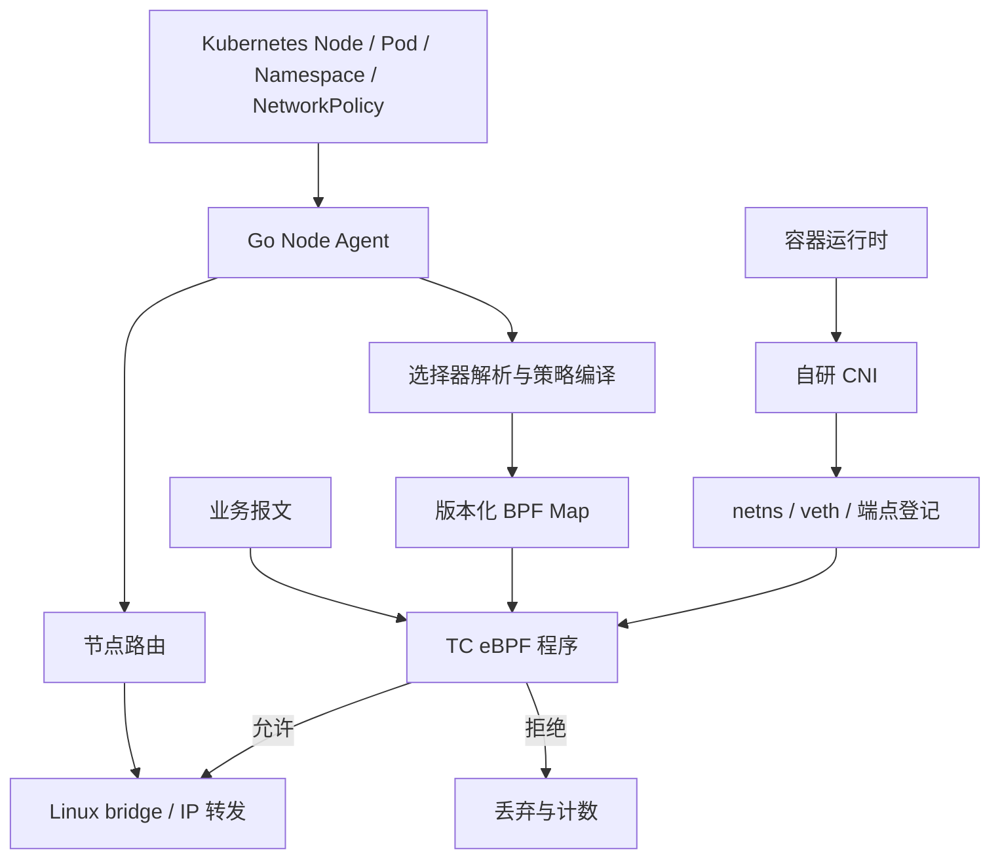

# KubeNetDoctor（工作名）— 最小 CNI 与 eBPF 网络策略数据面

修订日期：2026-11-16。目标：CNI、容器网络控制面与数据面开发岗位。

状态：设计，尚未实现。目录和工作名暂时保留，功能定位以本文为准。历史方案位于 `docs/archive/`，不再作为当前实施要求。

## 一、项目目标：实现网络功能

> 实现一个具有基本 Pod 连通能力的 CNI 原型，并自主开发 Go 策略编译器与 TC eBPF L3/L4 策略执行程序，使 Kubernetes 中的 Pod/策略变化真正改变内核对报文的放行和丢弃行为。

项目围绕一条主线：**网络对象 → 策略编译 → BPF Map 发布 → 内核逐包执行 → 行为与性能验证**。

网络控制器、幂等和异常恢复仍是必要工程能力，但交付中心是实际的网络功能。配置检查、指标和日志只服务于开发调试与验收。删除诊断 Manager、跨层根因推断、Hubble Adapter、追踪会话平台作为必做交付的要求；TCP 重传探针也不占主线阶段。

自主实现的部分：

1. CNI 网络附件的创建、检查、删除和失败回滚。
2. Node/Pod/Namespace/策略对象到节点路由、端点身份与策略表的转换。
3. TC eBPF 报文解析、L3/L4 匹配、放行/丢弃、计数和有界 TCP 返回流状态。
4. 版本化规则发布、端点重建与地址复用处理、控制面重启恢复。

复用 Linux bridge/IP 转发、host-local IPAM 和 Kubernetes API。首版不实现完整 TCP/IP 协议栈、Service NAT/LB、BGP、VXLAN 或生产级分布式 IPAM。策略过滤本身是数据面功能；简历准确描述为“自研 eBPF 策略数据面”，不宣称实现全部 eBPF 转发或完整 Cilium。

## 二、范围与兼容性声明

### 2.1 首版环境

- 单 Kubernetes 集群、Linux、IPv4、普通 Pod、固定 containerd/CNI/内核/Go/Clang/cilium-ebpf 版本。
- 每节点 bridge + Pod veth，跨节点用受控二层 underlay 上的直接路由，保留 Pod 源地址。
- 专用实验 Namespace 中的 PodIP 直连 TCP 为策略验收对象，先同节点，再独立内核的跨节点。
- 分阶段开发：先用明确的实验 ACL 格式验证无状态内核过滤；返回流状态完成后再接入声明范围内的 Kubernetes NetworkPolicy。早期 ACL 不对外宣称 NetworkPolicy 兼容。
- kube-proxy 可作为集群基础设施保留，但首版策略兼容性不覆盖 ClusterIP/NAT 前后规则、NodePort、Pod 出网、hostNetwork、多网卡、IPv6、UDP、SCTP、Service Mesh。
- 不将项目与其他主 CNI 混装。Cilium 只可用于独立环境的学习或对照，不是本项目必需组件。

### 2.2 有限 NetworkPolicy 语义

目标适配以下受控子集，实施前用表格列出支持/拒绝的具体字段：

- 只处理明确声明 `policyTypes: [Ingress]` 的策略；只控制实验端点的入站 TCP 新连接。
- 目标和来源选择器支持 `matchLabels`，来源支持同 Namespace 的 podSelector、namespaceSelector，以及同一 peer 中两者组合的 AND 语义；不同 peer/规则/策略按允许集合合并。
- 支持空目标选择器、空 ingress 列表形成默认拒绝、数字 TCP 目的端口与省略端口表示所有 TCP 端口；省略 from 表示来源不受该规则限制。每种省略/空集合含义均需测试，不能一概按空列表处理。
- 首版拒绝 Egress、matchExpressions、ipBlock、命名端口、endPort 及未实现协议；不能静默跳过字段后声称策略已生效。
- 未被入站策略选中的实验端点，其支持范围内入站 TCP 不被隔离；已被选中的端点按所有适用允许规则的并集匹配。
- 返回流隐式放行依赖经验证的连接状态，不通过“有 ACK 位就放行”实现。
- 本机节点到本机 Pod、其他协议和非实验端点等行为单独列出实测边界。未实现标准要求的例外和全套语义之前，不宣称 Kubernetes NetworkPolicy 全量合规。

Kubernetes 策略的并集规则、入站/出站区分以及允许连接的返回流语义依据 [NetworkPolicy 官方定义](https://kubernetes.io/docs/concepts/services-networking/network-policies/)。本项目采用子集，是明确的功能限制。

Kubernetes API 仍可能接受本插件不支持的策略；编译器不能替代 API Server 拒绝创建。遇到影响实验范围的不支持对象，Agent 报错并将能够确定受影响的端点置为 TCP 隔离；无法确定目标范围时隔离整个受管实验 Namespace 的 TCP，不能留着旧允许规则却显示成功。此保守失败行为需单独测试和说明，不作为标准策略语义。

## 三、控制面与数据面



| 组件 | 核心职责 |
|---|---|
| `knd-cni` | runtime 调用入口；创建/清理附件；委托 IPAM；与本节点 Agent 完成端点登记 |
| `knd-agent` | client-go 缓存与编译；路由维护；BPF 加载、挂接、Map 发布；端点生命周期 |
| `bpf/` | 每包解析、规则查询、有限 TCP 状态、PASS/DROP、计数 |
| `kndctl` | 查看已发布策略版本、端点、Map 与计数；用于开发调试 |

没有独立 Manager 或集中式报文处理服务。业务报文不经过 Go/gRPC。Agent 与 CNI 的本机端点协议采用有权限控制的 Unix socket，接口幂等并设超时；Agent 不可用时拒绝新的受管端点接入，保留已配置端点的既有内核执行状态。

## 四、CNI 与基础连通性

首阶段实现 CNI spec 1.0.0 的 ADD/DEL/CHECK/VERSION，固定实际库版本和 runtime，暂不声称支持 1.1 STATUS/GC。[CNI 1.0 规范](https://github.com/containernetworking/cni/blob/spec-v1.0.0/SPEC.md)

地址来自 Node.spec.podCIDR；集群预先启用互不重叠的节点网段分配。委托 host-local 管理节点内分配与释放，全局唯一性来自节点网段不重叠。[host-local](https://www.cni.dev/plugins/current/ipam/host-local/)

Agent 使用 hostNetwork，通过可达 API Server 地址引导，不先依赖 Pod 网络或 ClusterIP。它准备节点 bridge、网关和原子发布的 CNI 配置。M1 无完整 Agent 时，用测试夹具调用相同初始化逻辑。

ADD 创建 veth、配置 Pod 地址与路由；DEL 按 network/containerID/ifName 清理，不误删共享 bridge，netns 不存在仍释放 IPAM；CHECK 核对接口与配置并调用委托插件检查。标准结果写 stdout，日志写 stderr。处理失败回滚、并发 ADD、重复 DEL、接口名冲突和进程异常退出后的显式清理。

接入策略阶段后，新增端点先登记唯一 endpoint ID/epoch，安装默认 TCP 隔离和必要基础协议行为，挂接程序并确认策略状态，再完成 ADD。初版 CNI 配置成功不代表已经实现这项策略就绪保证；M5 必须补齐并测试。

CNI 原始参数中的容器/Pod 信息需要与 Kubernetes 元数据核验；IP、Pod 名称、ifindex 均不能单独当长期身份。持久记录使用原子更新；netns 操作使用有正确线程锁定/恢复行为的成熟工具。

Node Agent 将远端 PodCIDR → 节点下一跳编程到 Linux 路由，以受限所有权标记管理项目资源。Informer/Workqueue 重算最新期望，幂等下发并读回；API 中断不清空路由，不接管已有非项目路由。该模块只负责基础连通性，不扩展成配置审计平台。

直接路由需要真实的下一跳可达、双向路由、IPv4 forwarding、正确 MTU、宿主转发规则及 underlay 允许携带 Pod 源地址。云上同一子网不保证满足这些条件。不能为省事清空整个宿主防火墙。

## 五、TC eBPF 策略执行程序

### 5.1 挂接位置和方向

选择 host-side Pod veth 的 TC hook，而不是 TCP tracepoint。TC 程序可以返回实际报文处理动作；tracepoint 主要观察内核事件。[TC BPF 机制](https://docs.cilium.io/en/stable/reference-guides/bpf/progtypes/)

```text
Pod 发出 → host veth ingress → 记录/验证本地发起流与源身份 → Linux 转发
Linux 转发 → host veth egress → 对目标 Pod 执行 ingress 策略 → Pod 收到
```

“网卡 ingress/egress”与“Pod 入站/出站”不是同一个视角。首先用最小实验验证同节点、跨节点、回包各经过哪些 hook，再接策略。

首版选择一种固定的挂接方式。优先评估经典 TC clsact + direct-action；如果目标内核与库更适合 TCX，则在 M0 固定并测试其动作和生命周期，不能混用两种返回语义。只管理自己的程序/过滤器，不盲删其他 qdisc/filter。

### 5.2 真正自行实现的报文逻辑

1. 解析 Ethernet、IPv4 和 TCP，检查包边界、头长度、字节序，避免 verifier 拒绝和越界。
2. 从目标端点和版本化状态获取 endpoint ID/epoch、来源身份和隔离状态。
3. 查询合法返回流状态；否则根据源端点、TCP 目的端口等匹配允许规则。
4. 返回放行动作或丢弃动作；按端点、方向、规则/原因计数。

明确处理 IPv4 options、分片、截断包、非线性 skb 和 GSO/GRO。首版不做分片重组；受管路径上的 IPv4 分片拒绝并计数。TCP 头不可安全读取时拒绝，不能解析失败后直接放行。VLAN、其他封装与未支持协议列入显式处理表；ARP 等基础协议行为与 TCP 策略分开，不能一条默认 DROP 破坏整个网络。

使用正确的 skb 读取方式并测试非线性数据，不能把 data/data_end 当成始终包含完整 TCP 头。计数单位首先定义为 hook 观察到的 skb/处理次数，不能冒称线上物理报文数。

本阶段不修改 IP/端口，不实现 NAT 和校验和重写。接口创建与路由之外，自研内核逻辑实际决定的是网络访问控制行为。

### 5.3 返回流状态：从 ACL 到连接策略

M2/M3 的无状态 ACL 只做报文过滤实验，不接管 NetworkPolicy。M4 加入有界 TCP 流状态后，才能支持规定范围内的入站连接策略：

- 在本 Pod 发出新连接 SYN 时记录发起方向；在入站新连接被允许时记录批准状态；随后对握手与返回方向做状态校验。
- 不能让任意 ACK 建立“已连接”项；验证五元组、方向、端点 epoch、TCP 标志和必要的握手状态。
- 明确定义 SYN 重传、半连接超时、RST/FIN、tuple 复用、并发状态更新和清理规则；这是有限连接跟踪，不是完整 TCP 协议栈或生产级防火墙。
- Map 容量有限；新状态插入失败时拒绝依赖该状态的新连接并记录原因。若采用 LRU，必须说明驱逐可能中断已有连接，不能把状态缺失当作已允许。
- 首版策略变更对新连接生效；已经批准的连接可保持至关闭/超时，限制最大保留时长。该选择写入测试；端点删除或 epoch 变化立即使旧状态失效，不能沿用到同 IP 新 Pod。
- 状态按节点和本地端点管理，不能假设跨节点共享同一个 socket/连接 ID。首次接入时的既有连接无可靠状态则需要重建，不凭观察到一个中途 ACK 推断已授权。

各规则在 M4 编码前形成状态转移表和包序列测试。若返回流/连接复用仍不能正确处理，停止宣称具备 NetworkPolicy 适配能力，保留为实验 ACL。

## 六、Go 控制面：策略编译与发布

### 6.1 编译管线

```text
Pod / Namespace / NetworkPolicy 快照
 → 支持字段验证
 → 目标与 peer 选择器求值
 → 规范化允许集合与隔离标记
 → 有界节点规则表
 → 发布新版本并读回核验
```

这部分的开发重点是将声明式网络意图转换成内核能查询的数据结构，包含选择器语义、规则并集、标签变更、Pod 删除、地址复用及不支持字段处理。

初版限定实验规模，以确定性的重算与差异发布为主，不先追求复杂增量算法。规则展开有明确端点数/条目数/内存上限；超限必须失败和报错，不能截断后继续声称策略完整。

IP→端点身份映射携带 Pod UID/epoch；标签变化需要重编译受影响规则。宿主 veth ingress 校验本地 Pod 的源 IP 与登记身份，防止简单源地址伪造破坏匹配。跨节点首版信任实验节点与 underlay，不宣称具有加密身份或对抗恶意节点的能力。

### 6.2 发布一致性

候选方案采用 map-in-map：在新 inner map 中构建完整节点规则快照，再替换 outer map 中的引用。单次 BPF 执行只获取一次快照引用，并在该快照完成身份与规则查询。相关元数据必须在同一快照内或遵守可验证的版本协议，不能把多个独立 Map 更新误称为原子事务。[Linux map-in-map](https://docs.kernel.org/bpf/map_of_maps.html)

规则使用带类型的键区分身份、隔离标志与匹配项；通配匹配顺序固定且有界。策略 generation 与端点 epoch 分开：前者表示规则版本，后者隔离端点生命周期。旧 inner map 生命周期按内核引用机制处理，不人为假设切换时所有在途包瞬间结束。

节点内发布原子性不等于集群原子性。各节点独立收敛，明确记录 desired/applied generation 和更新时间；跨节点更新期间可能短暂不一致，需要实验验证。

Agent 重启后校验 pinned map/program 的 ABI 与所有权，并按 Kubernetes 最新对象恢复；版本不兼容时不能把旧内存布局强行解释为新结构。端点删除时先隔离/失效状态，再清理挂接和资源，防止 ifindex 或 IP 复用误命中。

## 七、开发阶段与验收

| 阶段 | 开发任务 | 通过条件 |
|---|---|---|
| M0 机制验证 | 验证环境；手工 netns/veth；TC 程序真实加载 | 正确观察两个 hook 方向；指定 TCP 报文被自身程序放行或丢弃 |
| M1 最小 CNI | CNI 生命周期、host-local 委托、Linux 基础连通性 | 标准结果、同节点 TCP、重复 DEL、ADD 回滚、地址回收 |
| M2 eBPF ACL | 自研包解析、有限规则 Map、动作与计数 | 规则真实控制报文；错误头/分片/非线性 skb 的处理有测试 |
| M3 策略编译基础 | Go 选择器/规则规范化；端点身份；快照发布 | 编译器纯逻辑测试；变更能改变内核动作；无半套规则窗口 |
| M4 TCP 流状态 | 握手/返回流/关闭/超时/容量/复用处理 | 包序列与真实 TCP 测试；无 ACK 无条件绕过；旧端点状态不泄漏 |
| M5 Kubernetes 集成 | Node 路由、Informer、有限 NetworkPolicy、CNI 策略就绪 | 同/跨节点策略执行；默认拒绝、允许并集、标签变化、Agent 重启均正确 |
| M6 工程与性能 | 端到端回归、负载测试、资源上限、源码讲解与 README | 功能边界可复现；性能数据有基线；核心实现能独立解释 |

顺序有意让 TC 报文处理尽早出现，不把前几个阶段全部用于搭建集群平台。M3 可演示自研 ACL；M5 才形成 Kubernetes 网络功能闭环。

### 必测场景

- 同节点/跨节点通信；源标签和目标标签分别改变；多个允许策略合并；默认拒绝；删除最后一个入站隔离策略。
- Namespace 与 Pod selector 的组合、空值和省略；非法或不支持规则不会被静默当作成功。
- 被允许的新连接、被拒绝的新连接、返回流、双向独立连接、SYN 重传、RST/FIN、半连接与 tuple 复用。
- 对同一源端口不同连接/不同 Pod 的区分；Pod 删除、同 IP 新 Pod、ifindex 复用不继承旧授权。
- 更新规则时持续发包，核对可见版本；节点间非同步更新单独测量，不假设全局同时生效。
- CNI 中途失败、Agent 重启/API 不可达、Map 满、流状态驱逐和程序重载的行为明确。
- 截断包、IPv4 options、分片、非线性 skb、offload 开关对解析与计数的影响。

### 性能口径

在相同网络与固定负载下比较：不挂接策略程序、挂接但允许全部支持流量、有实际规则和连接状态三种状态。测吞吐、连接建立率、延迟分布、CPU、Map 内存、规则发布耗时和策略生效延迟。报告规模、版本、重复次数与限制，不提前承诺性能提升。

测试工具和抓包用于证明网络行为；只看到 BPF 日志不能代替发送端/接收端的实际结果。使用测试运行器独立记录预期规则与报文，不让被测程序读取“正确答案”。

## 八、环境与工程边界

当前仅知 Windows 上安装过 Docker Desktop/WSL，之前 Docker Linux Engine 未连接且 WSL 查询遇到 E_ACCESSDENIED；实际内核、BTF、权限均未验证。M0 先做最小加载与 hook 实验。

本地 netns/容器可用于前期；最终多节点测试使用独立 Linux 内核。直接路由采用受控二层网络，不预设云环境允许 Pod 源地址转发。若环境不满足，先调整实验拓扑，不临时引入另一套 overlay 开发主线。

按阶段创建目录：

```text
cmd/knd-cni/          CNI 入口
cmd/knd-agent/        节点控制面与程序管理
cmd/kndctl/           开发调试工具
internal/cni/        生命周期、IPAM、附件记录
internal/network/    netns/netlink、基础路由
internal/controller/ informer/workqueue
internal/policy/     验证、选择器、编译、发布计划
internal/endpoint/   端点身份与生命周期
internal/datapath/   BPF 生成绑定、挂接、Map 发布
bpf/                 parser、policy、flow state、counters
deploy/              固定实验部署
tests/               包序列、Linux 集成、Kubernetes E2E
docs/                设计决策、兼容矩阵、实验和性能
scripts/             实验准备与清理
```

无需数据库、消息队列、诊断 CRD、Web UI 或独立管理服务。Go Modules、context、并发边界、退出清理与版本校验按实际需要实现。使用成熟 CNI/netlink/ebpf 库不等于委托全部业务逻辑；要清楚标注自主实现与复用。

特权集中在 CNI/节点 Agent，读取 API 使用所需只读 RBAC；Unix socket 与宿主目录限制访问，BPF/网络权限在实际环境验证。正常使用不允许调试工具修改其他网络实现的资源。

交付重点是源代码、可复现实验、策略兼容矩阵、数据路径说明与性能报告。原有重传探针、Hubble 和根因报告只保留为未来可选研究方向，不作为本项目完成条件。

## 九、协作方式

保留原八条规则。每阶段先解释协议/报文路径、控制面转换和内核执行，再分成可以理解和验证的小任务；每次只完成当前阶段。中文注释解释函数职责和复杂逻辑，不用堆砌文件数量代替理解。

遵循以下开发方式。

### 规则 1：先理解项目，再修改代码

每次开始新阶段之前：

- 阅读已有代码。
- 检查当前架构。
- 检查已有测试。
- 明确本阶段改动范围。
- 识别技术风险。

不得在未检查现有实现的情况下重复创建模块。

### 规则 2：一次只完成一个阶段

你需要了解整个项目架构，但每次只实现当前阶段。

不能因为知道最终目标，就一次性生成整个项目的所有文件。

当前阶段必须具备独立验收能力。

### 规则 3：每阶段先给出技术方案

开始写代码前，简要说明：

- 本阶段开发目标。
- 需要创建或修改的模块。
- 核心数据结构和接口。
- 使用的关键 Linux/Kubernetes 机制。
- 技术风险。
- 验收方法。

之后再进行实现。

### 规则 4：完成后必须测试

在环境允许的情况下，主动执行：

- 编译。
- 单元测试。
- 集成测试。
- 静态检查。
- 必要的真实运行测试。

如果环境无法执行某项测试，必须明确说明未执行原因，不能报告测试通过。

### 规则 5：保留工程文档

在 docs/ 中维护：

- architecture.md
- development-plan.md
- technical-decisions.md
- known-limitations.md
- testing.md

每次出现关键架构决策时更新文档。

### 规则 6：保证我能够理解核心代码

每完成一个核心模块，你需要解释：

- 为什么这样设计。
- 核心代码的工作原理。
- 与 Kubernetes/Linux 内核的关系。
- 哪些情况下可能失败。
- 与成熟开源工具的差异。
- 面试中可能被问到的技术问题。

不要仅仅告诉我已经完成了多少代码。

### 规则 7：禁止无意义的复杂化

在加入新依赖、新服务或新抽象前，判断：

- 是否有现成可靠组件可以复用？
- 自研是否有明确价值？
- 是否增加了无法验证的复杂性？
- 是否有对应的实验和测试？

如果某个功能没有实际收益，可以建议删除或延后。

### 规则 8：每阶段汇报

每个阶段完成后，输出：

1. 已完成任务。
2. 主要代码文件。
3. 关键技术实现。
4. 执行过的测试及结果。
5. 未解决的问题。
6. 与原计划的偏差。
7. 下一阶段建议。

只有当前阶段通过验收，才能进入下一阶段。

## 十、实施前需要落定的设计

1. M0 实测并固定 TC/TCX 挂接、程序动作、可用 helper、BTF 与工具链版本。
2. M2 明确每类报文的解析与处理表，以及不支持协议的基础联网行为。
3. M3 明确规则表键值、通配匹配、身份与策略快照布局、容量与发布失败行为。
4. M4 完成 TCP 状态转移表、并发更新、清理与容量策略，再决定可声明的返回流语义。
5. M5 逐项落实 Kubernetes 子集、策略就绪与原子发布测试；不支持即标记，不用演示成功冒充完整兼容。

所有性能、合规和兼容性结论以实际验收为准。下一步首先完成 M0 的最小 TC 放行/丢弃实验。
