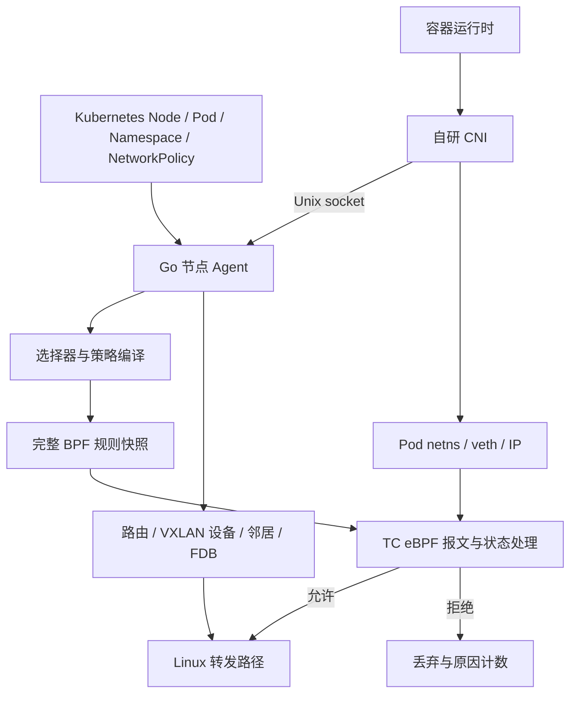

# KubeNetDoctor（工作名）— CNI 与 eBPF 网络数据面开发方案

修订日期：2026-11-16，v4。目标：CNI、容器网络控制面与数据面开发岗位。

**状态：实施前设计，尚未实现。** 目录与工作名暂时保留。当前设计由本文与下列专项文档共同组成；`docs/archive/` 仅记录历史，不作为当前需求。

## 一、项目定位与岗位依据

> 实现一个具备 Pod 连通能力的 CNI 原型，自主开发 Go 策略编译器与 TC eBPF 报文处理程序；使 Kubernetes 对象变化转化为内核规则，真正控制连接的允许与拒绝，并在原生路由和 VXLAN 两种路径下验证行为与性能。

主线是 **网络对象 → 编译与发布 → 内核逐包执行 → 真实网络行为 → 性能分析**。控制器、幂等、状态恢复是实现网络功能的组成部分；交付中心是源代码和网络机制。

用户提供的七张截图包含四个岗位、三种工作重心。主要对齐“容器网络开发”的两张截图：CNI、Underlay/Overlay、Go/C、TCP/IP、eBPF 与性能优化。SRE 和集群管理 JD 作为工程能力参考，不据此增加集群生命周期、调度、容量管理或运维平台。

NetworkPolicy 是我们选定的网络开发载体，并非 JD 指定的唯一功能。它能让控制面编译和数据面行为形成完整链路；VXLAN 和性能实验补充拓扑及性能能力。详细对应关系、自研边界与经验缺口见 [岗位映射](docs/jd-alignment.md)。

用户学过 Go/C、熟悉 Linux 和计算机网络理论，可充分投入。**不安排独立 TCP 收发程序实验**；直接从 netns/veth/TC 切入，使用现成工具产生流量，把需要的网络编程机制放入实际模块讲解。

## 二、设计文档与阅读顺序

| 文档 | 负责回答的问题 |
|---|---|
| [岗位映射](docs/jd-alignment.md) | 为什么做这些功能，怎样对应 JD，哪些能力不能由此证明 |
| [网络拓扑](docs/network-topology.md) | 包怎样走；native/VXLAN、地址、MTU、设备与转发表如何设计 |
| [组件与接口](docs/architecture.md) | 谁管理什么；CNI/Agent 如何协作；身份、事务、重启如何处理 |
| [数据面与策略](docs/datapath-and-policy.md) | TC hook、报文处理、策略语义、Map、TCP 状态与并发如何设计 |
| [测试与性能](docs/testing.md) | 用什么实验判定正确；如何测量开销和优化效果 |
| [开发计划](docs/development-plan.md) | 每阶段先做什么、估计工作量、何时可以形成可展示成果 |
| [技术决策](docs/technical-decisions.md) | 为什么选这些技术，哪些决定仍需实机验证 |
| [已知边界](docs/known-limitations.md) | 不支持什么、哪些结论尚未验证、哪些经验不能宣称 |

首次阅读建议：本文 → 拓扑 → 组件与接口 → 数据面与策略 → 开发计划/测试。字段语义、接口、状态机的细节以各自负责的专项文档为准，避免在多处维护不同版本。

## 三、交付范围与自主开发内容

| 等级 | 交付 | 完成点 |
|---|---|---|
| R0 | 单节点 CNI/TC ACL 原型、Go 编译与规则发布 | M3；可展示真实过滤，不宣称已完成 NetworkPolicy |
| R1 | 原生路由 CNI、有限入站 TCP 策略、返回流与端点生命周期、初始性能记录 | M5；首个完整的 Kubernetes 网络项目成果 |
| R2 | 增加 Linux VXLAN 控制、两种路径对照、完整性能与优化实验 | M6–M7；面向所给容器网络 JD 的推荐交付 |

自主开发：CNI 附件生命周期与失败恢复；Node/Pod/Namespace/NetworkPolicy 到路由和规则表的转换；TC 解析/匹配/PASS/DROP；有限 TCP 返回流授权；版本发布、端点身份与状态恢复；基于剖析证据的优化。

复用：Linux bridge/IP 转发及 VXLAN 封装、host-local IPAM、Kubernetes API、成熟 CNI/netlink/netns/ebpf 库。复用库负责系统调用与基础设施，项目仍需自行定义和实现网络行为。

必做范围不含 Service NAT/LB、BGP、DPDK、RDMA、多集群、Web UI 或诊断平台。TCP 重传探针、Hubble Adapter 和根因推断不占开发主线。准确描述成果为“CNI 原型与自研 eBPF 策略数据面”，不宣称完整 Cilium 或全部 eBPF 转发能力。

## 四、组件与数据路径



| 组件 | 主要职责 |
|---|---|
| `knd-cni` | ADD/DEL/CHECK/VERSION、IPAM 委托、附件事务与本节点端点登记 |
| `knd-agent` | Kubernetes 对象同步、策略编译发布、路由/隧道控制、BPF 管理与恢复 |
| `bpf/` | 报文解析、身份与规则查询、有限连接授权、实际放行/丢弃与计数 |
| `kndctl` | 查询端点、版本、状态与计数，帮助开发验证 |

业务报文通过内核，不经 Go RPC 服务。CNI/Agent 的 Unix socket 只交换配置和生命周期信息。

在 host-side veth 上：**ingress 是 Pod 发出的方向，egress 是发往 Pod 的方向。** 前者核验本地源身份、维护出站发起状态；后者执行目标端点的入站策略及返回流判断。先在 netns 实验中验证，再做集成。

同节点使用 bridge；跨节点先做保留 Pod 源 IP 的直接路由，后做 routed VXLAN。两种路径共用端点策略 hook，匹配内层 Pod IP。VTEP 不加入 Pod bridge；其路由、邻居与 FDB 由 Agent 管理。具体报文路径见 [拓扑文档](docs/network-topology.md)。

## 五、必须先说清楚的设计约定

1. **CNI 启动不能循环等待。** Agent 使用 hostNetwork 与实际 API Server 地址引导。ADD 通过可信 Pod UID 核验身份，并以本次分配的 IP 登记；不能等待 ADD 之后才可能回写的 Pod.status.podIP。
2. **接口配置成功与策略就绪分开。** M1 的 connectivity-only 只验证连通；M5 的 policy-enforced 要求端点先阻断、挂程序、发布策略，再启用链路并返回 ADD 成功。
3. **策略子集必须准确。** 只适配固定实验 Namespace、IPv4 普通 Pod 直连 TCP 的 Ingress 子集。支持 matchLabels、数字端口、正确的 selector AND/OR 与多策略允许并集；空值/省略语义逐项定义。不支持字段显式报错，并确认受影响 TCP 隔离是否真正生效。
4. **其他协议有明确处理表。** UDP/SCTP 等显式旁路，ARP/ICMP 保留基础行为；分片、非法头等按约定拒绝。因此本项目的 TCP 隔离不代表所有协议隔离。
5. **规则发布不等于全局事务。** 单次 BPF 执行读取一次完整快照，节点内通过 map-in-map 引用切换。binding/流状态/路由及不同节点的更新没有全局原子保证。
6. **返回流不能仅凭 ACK 放行。** 有限状态机核验握手、方向、端点代际与时间；并发更新、初始化和回收均需真内核测试。HASH + spinlock + BPF timer 是待 M0/M4 验证的候选实现。
7. **身份与授权有生命周期。** IP/ifindex 不是永久身份；本地 endpointID/epoch 与远端 Pod UID 映射分别管理。普通策略更新保留已批准流至关闭/期限；端点删除、身份失效和异常隔离优先于旧授权。远端 API 传播窗口如实记录。
8. **VXLAN 与性能有边界。** 复用 Linux 封装，自己开发其控制；R2 验证两种固定模式，暂不实现自动混合选路。使用 eBPF 本身不证明加速，收益由对照实验决定。

完整的接口请求/响应、ADD/DEL 状态机、Map 逻辑结构、TCP 转移表、候选超时与容量已分别写入专项文档。C/Go 字节布局、helper 能力、实际内存和版本在对应阶段实测后冻结，不把纸面设计当作兼容性证据。

## 六、开发顺序与验收

| 阶段 | 核心内容 | 验收重点 |
|---|---|---|
| M0 | 环境、netns/veth、最小 TC 放行/丢弃、Map/锁/timer 能力 | 真实内核与真实接收结果；固定可用技术基线 |
| M1 | 单节点 CNI | runtime 接口规范、IPAM、连通、重复 DEL、失败回滚 |
| M2 | TC ACL | 安全解析、规则动作、边界报文、字节布局与计数 |
| M3 | Go 编译与版本发布 | selector 语义、规则并集、完整快照、容量与更新失败 |
| M4 | TCP 返回流授权 | 握手/重传/关闭、tuple 复用、多 CPU 与回收竞态 |
| M5 | Kubernetes/native 集成 | CNI 就绪、身份回写、跨节点策略、重启与基础性能 |
| M6 | VXLAN 控制 | 路由/邻居/FDB、内外层抓包、MTU与故障路径 |
| M7 | 回归与性能 | 相同条件的基线、剖析与单项优化、可复现展示 |

按每周约五个有效开发日，当前估计共 43–67 个开发日，约 9–14 周；这是包含学习与调试的规划量级，不是完工承诺。M0 后根据实况重估。投递日期尚未指定，R0/R1/R2 可以分级展示，不为凑齐关键词跳过正确性验证。

第一项实际任务是确定 Linux 环境，建立两个 netns 与 veth，用现成工具产生流量，挂最小 TC 程序验证选择性丢弃。不会先写 TCP 客户端/服务端，也不会直接生成整个项目。

测试矩阵覆盖 CNI 故障恢复、策略空值/并集、包解析、握手/返回流、IP/ifindex 复用、API/Agent 故障、native/VXLAN 和资源泄漏。性能比较同路径无 BPF、最小解析、完整规则状态及有依据的单项优化。详见 [测试计划](docs/testing.md)，其中所有候选门槛均未执行。

## 七、环境与工程组织

前期可用一个 Linux 环境做 netns 实验；正式跨节点使用独立内核的虚拟机，推荐控制平面加两工作节点。kind 只能证明部分部署/API 行为，不用作独立内核故障隔离或真实多机性能证据。

实际机器资源、内核/BTF/权限、runtime 参数、网络地址与软件版本尚待 M0 核实。候选 Linux 6.6/6.8 系列不等于已验证支持范围。没有部署、安装系统依赖、修改宿主网络或购买环境的执行结果。

按阶段创建源代码目录，下面只定义组织方式：

```text
cmd/knd-cni/          CNI 入口
cmd/knd-agent/        节点控制面与 BPF 管理
cmd/kndctl/           开发查询工具
internal/cni/        附件、IPAM、事务
internal/network/    netns/netlink、bridge、路由、VXLAN
internal/controller/ informer/workqueue
internal/policy/     校验、选择器、编译、发布计划
internal/endpoint/   端点身份与生命周期
internal/datapath/   BPF 绑定、挂接、Map 发布
bpf/                 parser、policy、flow state、counters
deploy/              固定实验部署
tests/               包向量、Linux 集成、Kubernetes E2E
docs/                设计、边界、实验与性能
scripts/             实验准备和受限清理
```

CNI/Agent 的宿主权限、只读 Kubernetes RBAC、本地 socket 权限和资源所有权都在实验中核验。只管理本项目资源，不清空宿主防火墙或删除他人 qdisc/filter 来绕过问题。

## 八、协作方式

保留原八条规则。每个小任务解释报文路径、控制面转换或内核执行中涉及的机制；中文注释用于函数职责和复杂逻辑。只有当前阶段实际验收后才进入下一阶段。

遵循以下开发方式。

### 规则 1：先理解项目，再修改代码

每次开始新阶段之前：

- 阅读已有代码。
- 检查当前架构。
- 检查已有测试。
- 明确本阶段改动范围。
- 识别技术风险。

不得在未检查现有实现的情况下重复创建模块。

### 规则 2：一次只完成一个阶段

你需要了解整个项目架构，但每次只实现当前阶段。

不能因为知道最终目标，就一次性生成整个项目的所有文件。

当前阶段必须具备独立验收能力。

### 规则 3：每阶段先给出技术方案

开始写代码前，简要说明：

- 本阶段开发目标。
- 需要创建或修改的模块。
- 核心数据结构和接口。
- 使用的关键 Linux/Kubernetes 机制。
- 技术风险。
- 验收方法。

之后再进行实现。

### 规则 4：完成后必须测试

在环境允许的情况下，主动执行：

- 编译。
- 单元测试。
- 集成测试。
- 静态检查。
- 必要的真实运行测试。

如果环境无法执行某项测试，必须明确说明未执行原因，不能报告测试通过。

### 规则 5：保留工程文档

在 docs/ 中维护：

- architecture.md
- development-plan.md
- technical-decisions.md
- known-limitations.md
- testing.md

每次出现关键架构决策时更新文档。

### 规则 6：保证我能够理解核心代码

每完成一个核心模块，你需要解释：

- 为什么这样设计。
- 核心代码的工作原理。
- 与 Kubernetes/Linux 内核的关系。
- 哪些情况下可能失败。
- 与成熟开源工具的差异。
- 面试中可能被问到的技术问题。

不要仅仅告诉我已经完成了多少代码。

### 规则 7：禁止无意义的复杂化

在加入新依赖、新服务或新抽象前，判断：

- 是否有现成可靠组件可以复用？
- 自研是否有明确价值？
- 是否增加了无法验证的复杂性？
- 是否有对应的实验和测试？

如果某个功能没有实际收益，可以建议删除或延后。

### 规则 8：每阶段汇报

每个阶段完成后，输出：

1. 已完成任务。
2. 主要代码文件。
3. 关键技术实现。
4. 执行过的测试及结果。
5. 未解决的问题。
6. 与原计划的偏差。
7. 下一阶段建议。

只有当前阶段通过验收，才能进入下一阶段。

## 九、版本记录

- [v1：诊断工具方向](docs/archive/设计方案_v1_诊断方向.md)，原始方案存档。
- [v2：网络状态与诊断方向](docs/archive/设计方案_v2_网络状态与诊断.md)，不再作为主线。
- [v3：CNI 与策略数据面](docs/archive/设计方案_v3_CNI与策略数据面.md)，保留技术主线的前版。
- v4：当前版本；依据 JD 补齐拓扑、接口、状态机、测试和工作量，加入有边界的 VXLAN 交付，落实用户取消独立 TCP 收发实验的要求。

尚未解决的兼容性与环境事项集中见 [已知边界](docs/known-limitations.md)。下一次实施从 M0 的第一项小任务开始；本次修订只完成设计文档。
