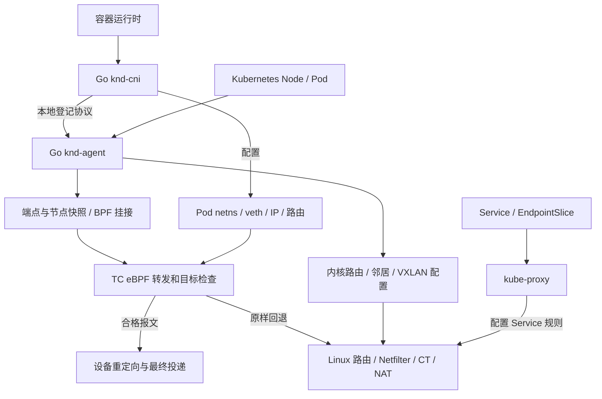

# KubeNetDoctor：以 eBPF 转发为核心的 CNI 项目设计

版本：v5，更新于 2026-11-17。状态：CNI/Agent、同节点与 Native/VXLAN eBPF 转发、Service 共存和辅助 ACL 已实现，并完成对应功能实验；DaemonSet 与短时性能对照已加入。长期稳定性、规模/完整性能矩阵尚未完成。实际进度见 [实施状态](docs/implementation-status.md)、[运行入口](README.md) 和 [环境报告](docs/environment.md)。目标是容器网络研发岗位，主线为 **自研 CNI 接入 + Go 节点 Agent + TC eBPF 三层转发**；Service 先交给 kube-proxy。

## 一、项目要完成什么

让 Kubernetes Pod 通过我们编写的 CNI 接入网络，由 Agent 将 Node/Pod 信息转换为路由和端点状态，再由我们编写的 eBPF 程序处理合格 Pod 报文：查询 FIB、核对目标、修改 TTL/校验和/MAC 并重定向。异常或需要内核连接处理的报文保留 Linux 路径。

这里的 eBPF 会主动转发报文，而不只是观察或 PASS/DROP。Linux 路由、邻居、TCP/IP、conntrack/NAT 和 VXLAN 仍是明确复用的能力；使用 eBPF 不代表必须重写全部网络协议。

不在开发集群直接用 Calico/Cilium 充当本项目 CNI；二者用于源码阅读和机制对照。VXLAN 是后续封装模式，可以与 eBPF 转发同时使用。kube-proxy 与项目分别承担 Service 和 Pod 网络职责。

## 二、文档索引

| 文档 | 负责说明 |
|---|---|
| [架构与接口](docs/architecture.md) | 组件所有权、CNI/Agent 协议、引导、生命周期与恢复 |
| [拓扑与报文路径](docs/network-topology.md) | /32 routed veth、同节点、Native、Service、VXLAN |
| [eBPF 数据面](docs/datapath-and-policy.md) | hook、快慢路径判定、头部处理、Maps、辅助 ACL |
| [Service 共存合同](docs/service-compatibility.md) | kube-proxy、conntrack、反向 NAT 与兼容门禁 |
| [开发阶段](docs/development-plan.md) | 每阶段自己实现/复用的内容、交付、估时和第一项任务 |
| [测试与性能](docs/testing.md) | 正确性矩阵、实际路径证据、性能对照与候选预算 |
| [技术决策](docs/technical-decisions.md) | 取舍、技术之间的关系、版本和待冻结参数 |
| [已知边界](docs/known-limitations.md) | 当前未验证项、支持范围与风险 |
| [JD 对齐](docs/jd-alignment.md) | 招聘要求到开发证据的映射 |

各项细节以对应专项文档为准。历史 v4 已完整归档，其 bridge、NetworkPolicy/TCP 授权阶段不再作为当前实施要求。

## 三、架构与自主开发边界

| 部分 | 我们自己写 | 复用 |
|---|---|---|
| CNI | ADD/DEL/CHECK/VERSION、IPAM 委托、veth/地址/路由配置、事务与清理 | runtime 的 netns、host-local、CNI/netlink/netns 库 |
| Agent | Node/Pod watch、本地登记、身份/快照编译、路由/邻居/隧道控制、BPF 管理与恢复 | client-go、Linux 网络对象、Go eBPF 库 |
| eBPF | 包解析、资格判断、CT 查询保护、FIB 结果校验、TTL/checksum/MAC、redirect、目标检查和计数 | helper/kfunc、内核 FIB/邻居、驱动 |
| Service | 共存分类与验收，不编写后端选择或 NAT | kube-proxy + Linux conntrack/NAT |
| VXLAN | 后期设备/路由/邻居/FDB 控制及隧道前后 BPF 转发 | Linux 封装/解封装 |

CNI 是 runtime 按需执行的用户态插件；Agent 是每节点常驻控制进程；eBPF 是内核中被 hook 调用的程序。业务数据包不经过 Go RPC 或 Agent。CNI 接口和生命周期由 Go 完成，网络数据面的关键转发由 eBPF 完成。

## 四、统一网络模型与数据包路径

每个普通 Pod 使用 /32 地址和自己的 veth，宿主不建 Pod bridge。Pod 经配置的网关 MAC 发送，宿主维护各 Pod 的 /32 路由及静态邻居；本机和跨节点路径都遵循三层语义。

**同节点快路径：** Pod A → host-veth-A ingress → 端点/CT/FIB 检查 → TTL 减 1、修正 IPv4 头校验和、改写 MAC → redirect 到 host-veth-C egress → 当前目标端点检查 → Pod C。

**Native 跨节点快路径：** Pod A → A 节点 veth ingress → FIB 选远端节点下一跳并修改头部 → A underlay 网卡 → B underlay ingress → 查本地目标、CT/FIB、修改头部 → B 的目标 veth egress → Pod B。每个执行三层转发的节点各减少一次 TTL；不做项目自有 Pod SNAT。

**慢路径：** 任一入口判定需要 Linux 时，保持原包继续内核路由/Netfilter；抵达 Pod 前仍执行相同目标 veth egress 检查。IPv4 options/分片、TTL/MTU 异常、邻居未就绪、初版大 GSO/GRO skb 等保留这条路径。明确伪造/非法报文与 ACL 拒绝是 DROP，不能用回退绕过。

**Service 路径：** Pod A → ClusterIP 因 VIP 分类回内核 → kube-proxy 规则 DNAT 到后端 B → 路由到 B。回包到达持有 NAT 状态的节点时，BPF 查询到内核 conntrack，交回 Linux 完成反向 NAT，客户端继续看到 VIP。只判断请求目的 VIP 会漏掉回包，详细合同见 [Service 文档](docs/service-compatibility.md)。

**VXLAN 路径，后期：** 源 BPF redirect 到隧道设备 → Linux 加上外层 NodeIP/UDP/VXLAN → underlay → 远端 Linux 解封装 → 隧道设备 ingress BPF 投递本地 Pod。内层 Pod 地址保持，封装由内核完成。

首版选择 TC `bpf_redirect(outIfIndex, 0)`；目标 host-veth egress 必须经实验证明同时覆盖重定向和普通内核路径。CT guard 候选是 `bpf_skb_ct_lookup`：命中或错误回内核，仅明确 miss 可继续快转；它依赖所选内核的实际能力，M0 先验证，不能把纸面设计当作已经兼容。

## 五、交付范围与关键约束

- **R0 / M2：** 自研最小 CNI + 同节点 eBPF 转发原型，能证明真实 redirect 和正确异常回退。
- **R1 / M4：** CNI/Agent + 同/跨节点 Native 快转 + kube-proxy Service 共存，是首个完整 Kubernetes 网络项目成果。
- **R2 / M7：** 增加辅助 ACL、VXLAN、生命周期回归与性能实验。

首版快路径为受控 IPv4 TCP/UDP Pod 直连。Service 固定 kube-proxy iptables 模式，记录实际 legacy/nft 后端；原生 nftables/IPVS 不一起扩张兼容矩阵。项目不会实现 Service replacement。

辅助 ACL 只做明确 Pod 对的无状态 TCP/UDP 拒绝，在目标端执行。完整 NetworkPolicy、选择器、有状态 ACL、自研 TCP 授权流表与 BPF timer 都后置。它们不再阻挡转发主线交付。

必须维护两种就绪：localReady 表示附件与 Linux 基线可用；fastReady 表示快转条件满足。缺少 CT kfunc、快照不完整或 Service 门禁未通过时不启用相应快路径，阶段仍记为未完成。

新增端点先有目标门禁与慢路径，再公布快转资格；删除先撤资格/阻断，再清理链路和租约。IP/ifindex 不是永久身份；使用 UID/epoch，承认远端 API 传播和路由/Map 非联合事务的边界。

## 六、开发阶段

| 阶段 | 主要自主开发 | 核心验收 |
|---|---|---|
| M0，3–5 日 | /32 拓扑与最小 TC/FIB/redirect/CT 探针 | 目标 hook 真正执行，CT 原始/回包查询可用，环境版本固定 |
| M1，5–7 日 | 最小 CNI、IPAM 委托、接口配置、事务回滚 | Linux 路由通信、重复 DEL/并发/失败恢复 |
| M2，6–9 日 | 同节点 BPF 转发、头部修改、目标检查、计数 | 真正快转，TTL 正确，异常回退，最小 NAT 夹具 |
| M3，6–9 日 | Agent、Node/Pod 同步、UDS、快照与节点路由 | 真实 Pod 启动、跨节点内核基线、初步 Service 集成 |
| M4，7–10 日 | Native 物理入口和远端快转、CT 兼容诊断 | 双节点双向快转；ClusterIP/DNS/hairpin/限定 NodePort；R1 |
| M5，4–6 日 | 小范围 ACL、身份复用/重启/资源恢复 | 快慢路径同一门禁，生命周期无持续泄漏 |
| M6，5–8 日 | VXLAN 控制与隧道前后快转 | 内外层抓包、MTU、重新验证 Service/ACL |
| M7，5–8 日 | 性能脚本、剖析、单项优化和回归 | 相同条件 B0–B3 对照，原始数据与真实路径比例；R2 |

按每周约五个有效开发日，候选工作量为 41–62 日，约 9–13 周；M0 后重估。投递日期尚未指定，可按通过的 R0/R1/R2 分级展示，不把估时当作承诺。

不安排独立 TCP 收发练习。第一项实施任务直接从 Linux 的两个 netns、/32 veth 路由和最小 TC redirect 开始，用现成工具产生流量，再验证目标 egress 的 DROP 确实生效。

## 七、测试与环境

验证分为 CNI 生命周期、包处理/路由、Service 返回转换、控制面变化、ACL、VXLAN、性能七组。仅“能够通信”不足以验收 eBPF 转发；需源 redirect 请求、目标 hook 和接收端证据一致。使用新连接并记录 CT 状态，避免已经走内核的连接掩盖快路径比例。

性能比较同拓扑的纯 Linux、只挂检查而强制慢路径、含 CT guard 的完整快路径、单项优化四组。记录 CPU/内存、吞吐/实际可测延迟、重复测量、快慢路径比例及原因；不预设 eBPF 必然更快。

前期一个 Linux 环境做 netns 实验；正式跨节点用独立内核 VM，候选为控制平面加两个工作节点。kind 可验证部分 API/部署，不能代替真实独立内核性能实验。机器、内核/BTF、权限、runtime UID 参数、地址和软件版本待 M0 实测。

源代码目录按阶段创建，详见架构文档。用户已授权连续实现完整项目；依赖和环境探针已准备，后续逐阶段验收并自动推进。实验使用隔离网络，实施事实与设计目标分开记录。

## 八、协作方式

保留原八条规则。每个小任务解释对应的包路径、控制面转换和 Linux 机制，函数职责与复杂逻辑使用中文注释。当前阶段实际验收后再进入下一阶段。

遵循以下开发方式。

### 规则 1：先理解项目，再修改代码

每次开始新阶段之前：

- 阅读已有代码。
- 检查当前架构。
- 检查已有测试。
- 明确本阶段改动范围。
- 识别技术风险。

不得在未检查现有实现的情况下重复创建模块。

### 规则 2：一次只完成一个阶段

你需要了解整个项目架构，但每次只实现当前阶段。

不能因为知道最终目标，就一次性生成整个项目的所有文件。

当前阶段必须具备独立验收能力。

### 规则 3：每阶段先给出技术方案

开始写代码前，简要说明：

- 本阶段开发目标。
- 需要创建或修改的模块。
- 核心数据结构和接口。
- 使用的关键 Linux/Kubernetes 机制。
- 技术风险。
- 验收方法。

之后再进行实现。

### 规则 4：完成后必须测试

在环境允许的情况下，主动执行：

- 编译。
- 单元测试。
- 集成测试。
- 静态检查。
- 必要的真实运行测试。

如果环境无法执行某项测试，必须明确说明未执行原因，不能报告测试通过。

### 规则 5：保留工程文档

在 docs/ 中维护：

- architecture.md
- development-plan.md
- technical-decisions.md
- known-limitations.md
- testing.md

每次出现关键架构决策时更新文档。

### 规则 6：保证我能够理解核心代码

每完成一个核心模块，你需要解释：

- 为什么这样设计。
- 核心代码的工作原理。
- 与 Kubernetes/Linux 内核的关系。
- 哪些情况下可能失败。
- 与成熟开源工具的差异。
- 面试中可能被问到的技术问题。

不要仅仅告诉我已经完成了多少代码。

### 规则 7：禁止无意义的复杂化

在加入新依赖、新服务或新抽象前，判断：

- 是否有现成可靠组件可以复用？
- 自研是否有明确价值？
- 是否增加了无法验证的复杂性？
- 是否有对应的实验和测试？

如果某个功能没有实际收益，可以建议删除或延后。

### 规则 8：每阶段汇报

每个阶段完成后，输出：

1. 已完成任务。
2. 主要代码文件。
3. 关键技术实现。
4. 执行过的测试及结果。
5. 未解决的问题。
6. 与原计划的偏差。
7. 下一阶段建议。

只有当前阶段通过验收，才能进入下一阶段。

## 九、版本记录

- [v1：诊断工具方向](docs/archive/设计方案_v1_诊断方向.md)，原始方案存档。
- [v2：网络状态与诊断方向](docs/archive/设计方案_v2_网络状态与诊断.md)，不再作为主线。
- [v3：CNI 与策略数据面](docs/archive/设计方案_v3_CNI与策略数据面.md)，前期方案存档。
- [v4：CNI、TCP 策略与 VXLAN](docs/archive/v4-policy/设计方案.md)，主文档和全部配套文档完整快照，附 SHA256 清单；不混用旧阶段要求。
- v5：当前版本；按用户要求聚焦 eBPF 主动转发，Service 复用 kube-proxy，改为三层 veth 拓扑，补齐反向 NAT、快慢路径、目标检查门禁，重排自主开发与验收阶段。

阶段功能与实际验收结果见上述进度记录；已知约束见 [边界文档](docs/known-limitations.md)。
